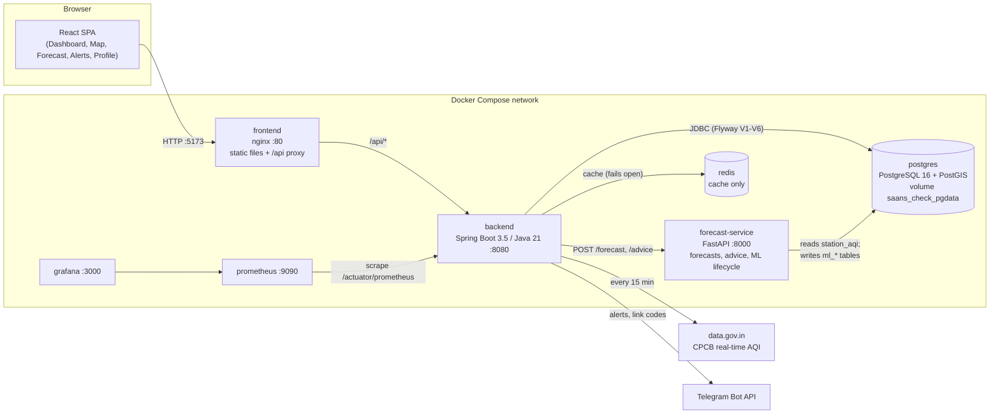
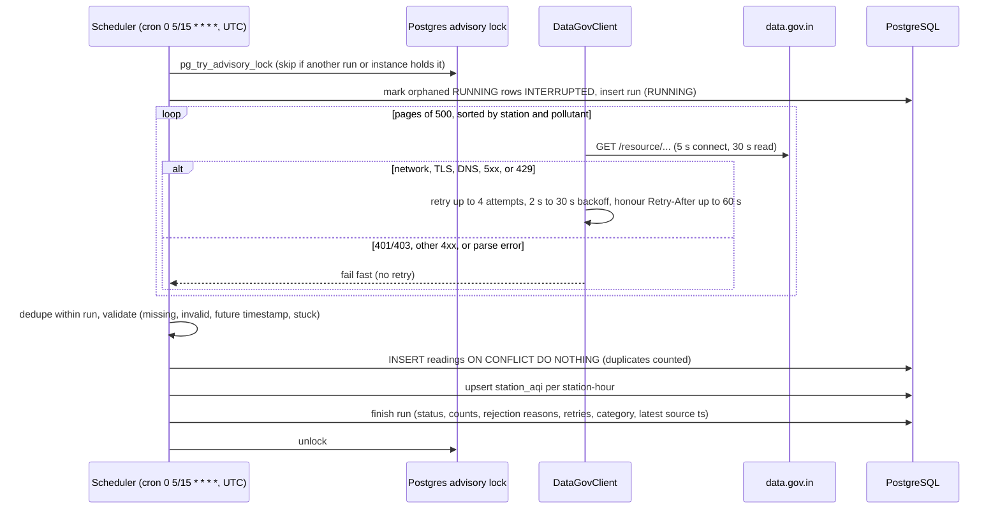
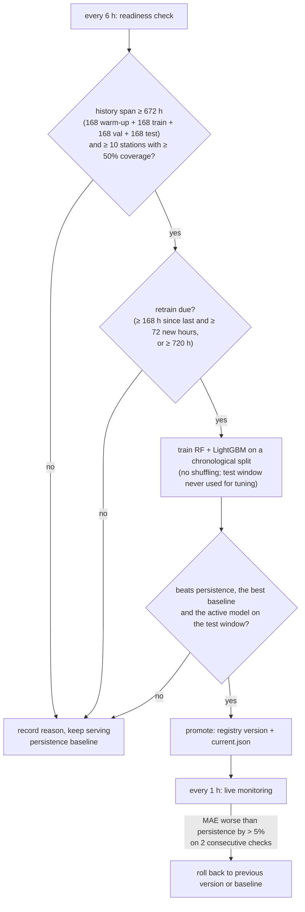

# VayuDrishti architecture (as implemented)

This describes the system that runs today with `docker compose up`. It was checked against the code and the
running stack on 2026-11-24. Nothing here is planned-only; limits are listed at the end.

## System

| Container | Host binding | Health check | Restart |
|---|---|---|---|
| frontend | 127.0.0.1:5173 | yes | unless-stopped |
| backend | 127.0.0.1:8080 | `/actuator/health` | unless-stopped, 45 s stop grace |
| forecast-service | 127.0.0.1:8000 | `/health` | unless-stopped |
| postgres | 127.0.0.1:5432 | `pg_isready` | unless-stopped |
| redis | 127.0.0.1:6379 | `redis-cli ping` | unless-stopped |
| prometheus / grafana | 127.0.0.1:9090 / :3000 | none | unless-stopped |

## Backend modules (`backend/src/main/java/com/saanscheck`)

| Package | Responsibility |
|---|---|
| `ingestion` | Scheduled fetch from data.gov.in. Handles retries and classification, validation, stuck/missing flags, idempotent storage, run history, and startup catch-up |
| `ingestion.health` | Health evaluation (HEALTHY … UNKNOWN), Prometheus gauges, and deduplicated admin notifications |
| `aqi` | CPCB AQI from pollutant sub-indices (bands in `aqi.yml`) |
| `stations` | Station list, PostGIS nearest search, current AQI, and history (Redis-cached hot reads) |
| `forecast` | Calls forecast-service with ≥ 24 valid hourly points from the last 168 h; reports `INSUFFICIENT_DATA` / `STALE_DATA` / `UNAVAILABLE` honestly |
| `alerts` | Threshold evaluation and Telegram delivery, at-most-once |
| `security`, `profile`, `telegram` | JWT authentication (HS256, BCrypt, login throttling), profiles, and the Telegram link-code flow |
| `common` | Error handling (RFC 7807), HTTP clients with timeouts, cache configuration, scheduling |

## Ingestion flow

* **Statuses:**
  * `SUCCESS`: the snapshot is complete, even if it brought **0 new observations**. That is normal; CPCB
    publishes once an hour.
  * `PARTIAL`: a later page failed, or fewer records arrived than the API reported.
  * `FAILED`: the run could not complete.
  * `INTERRUPTED`: the process died mid-run.
* **Start-up:** about 20 s after start, a `RECOVERY` run starts if the last success is older than 10 minutes.
* **Shutdown:** graceful. A run in progress finishes before the JVM exits (verified: a stop issued 3 s into a run
  let it finish as `SUCCESS`).
* **Source lag (measured):** an hour stamped `HH:30 UTC` first appears 35–50 minutes later. A healthy feed's newest
  observation is therefore 35–125 minutes old.

## Data model (main tables)

| Table | Key | Content |
|---|---|---|
| `stations` | `id` (slug of the station name) | name, city, state, `geography` point (GiST index), active |
| `readings` | (`station_id`, `pollutant`, `ts`) | sub-index value, quality OK / MISSING / INVALID / STUCK, raw value |
| `station_aqi` | (`station_id`, `ts`), plus an index on `ts` | hourly AQI, category, dominant pollutant, pollutant count |
| `ingestion_runs` | `id` | one row per run: trigger, status, counts, duration, retries, error category, HTTP status, latest source timestamp, rejection reasons (JSONB) |
| `ingestion_health_notifications` | `id` | every PROBLEM or RECOVERY notification and its recipient count |
| `ml_training_runs`, `ml_lifecycle_events`, `ml_lifecycle_state` | | ML lifecycle history |
| `users`, `profiles`, `alerts`, `telegram_link_codes`, `forecasts`, `historical_station_aqi` | | auth, alerting, history import |

The schema is owned by Flyway. Migrations V1–V6 are additive only.

## ML lifecycle (forecast-service)

* Only observed station-hours count. Gap-filled values never count toward readiness or toward the 24-point
  minimum for a forecast.
* Training failures back off (1 h, doubling, capped at 24 h). The active model, or the baseline, keeps serving.

## Forecast flow

1. The browser calls `GET /api/v1/stations/{id}/forecast`.
2. The backend loads that station's `station_aqi` for the last 168 h.
3. With fewer than 24 valid hours it returns `INSUFFICIENT_DATA`, and the forecast service is not called. If the
   newest observation is too old, it returns `STALE_DATA`.
4. Otherwise it calls `POST forecast-service /forecast`, which answers with `method` = `MODEL` (and a
   `model_version`) or `BASELINE_*`, plus 24 hourly points with intervals.
5. The frontend labels baseline forecasts as baselines and model forecasts with the model version.

## Observability

* **Prometheus** scrapes `backend:8080/actuator/prometheus`.
* **Ingestion metrics:**
  * `saanscheck_ingestion_health{status}`
  * `…_latest_observation_age_minutes`, `…_minutes_since_last_success`, `…_consecutive_failures`
  * `…_duration_seconds`, `…_runs_total{status}`, `…_new_observations_total`
  * `…_retries_total`, `…_errors_total{category}`, `…_skipped_locked_total`
  * `saanscheck_stations_fresh` and `…_stale`
* **Grafana dashboard "VayuDrishti"** (provisioned from `monitoring/grafana/dashboards/saanscheck.json`):
  stations, ingestion runs, data quality, alerts, forecast calls, API latency, and the ingestion-reliability row.
* **Public pipeline status:** `GET /api/v1/ingestion/health`, also shown on the dashboard's "Data pipeline" card.

## Known limits

* The data.gov.in feed only holds the current snapshot. **Hours missed while the stack is off are lost.**
* The backend is a single instance. While it restarts (about 12 s), nginx returns a 502 problem document and the UI
  retries automatically every 10 s.
* All host ports are bound to 127.0.0.1, so the app is usable only on this PC. Serving other devices needs a
  deliberate change, such as publishing nginx on the LAN; the backend should stay internal.
* Training needs about 28 days of continuous hourly data. Until then forecasts use the persistence baseline, and
  only once a station has 24 observed hours.
